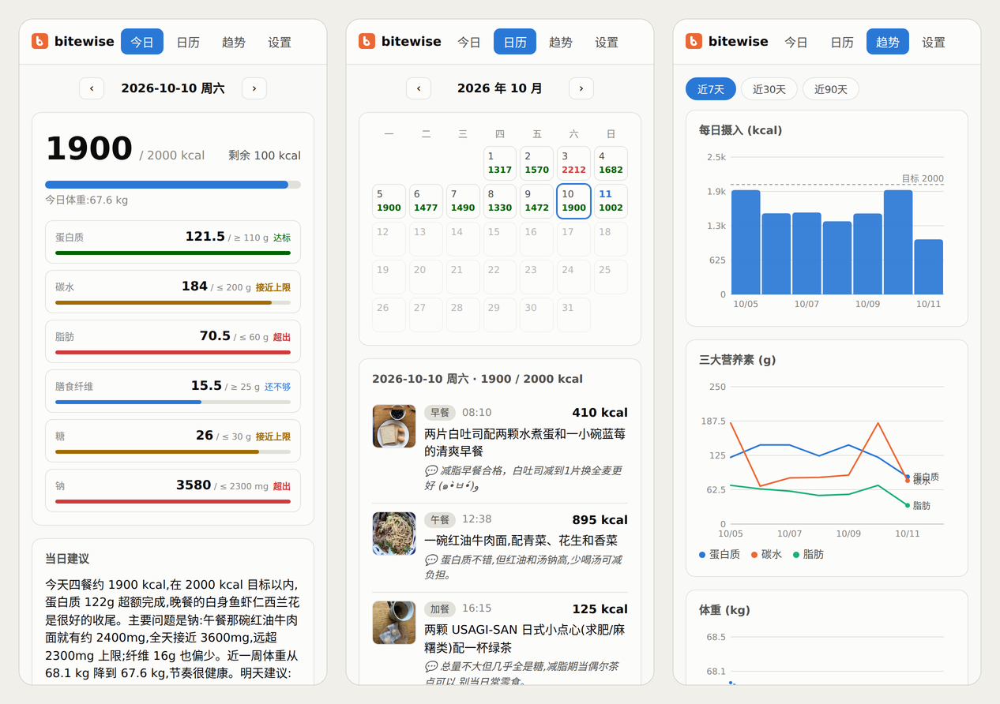

# bitewise

[English](README.md) | 简体中文

个人饮食记录工具:手机拍照/发文字 → 大模型(Claude / GPT / Gemini 任选)估算卡路里和三大营养素 → 网页 Dashboard 查看汇总、趋势和建议。一个服务可供多人使用,每人一个访问令牌,数据互相隔离。



## 工作方式

```
iPhone 快捷指令 ──HTTPS + Bearer token──▶ 反向代理(TLS) ──▶ FastAPI 服务(127.0.0.1)
浏览器 ─────────HTTPS + 登录 cookie─────┘                     ├─ token 决定用户,读写 data/<用户名>/
                                                              ├─ 立即入库返回,后台队列调模型 API 识别
                                                              ├─ 文字输入由 AI 判断意图:记饭 / 修正记录 / 记体重
                                                              ├─ 每晚按各用户设置生成当日总结建议
                                                              └─ 网页 Dashboard(今日 / 日历 / 趋势 / 设置)
```

- 每顿饭记录:描述、食物明细、卡路里、蛋白质/碳水/脂肪、一句 AI 点评
- 餐次按上传时间自动划分(早/午/晚/加餐),边界可在设置中调整
- 所有时间和日期(上传时间、餐次、"今天"、每日建议)都按每个用户在设置里选的时区计算(默认 `Europe/London`),与服务器所在时区无关
- 「我的目标」自由文本会注入每次 AI 调用,影响点评与建议口径
- 模型厂商可选 Anthropic(默认)/ OpenAI / Google,所有用户共用 `.env` 里的 API key,每人可在设置里改用的模型

## 运行

前置要求:Python ≥ 3.12、[uv](https://docs.astral.sh/uv/)、所选厂商的 API key(所用模型需支持图片输入)。

```bash
uv sync
cp .env.example .env                        # 选厂商并填入对应的 API key
.venv/bin/python -m bitewise add-user alice # 生成令牌并打印一次,记下来
.venv/bin/python -m bitewise                # 默认监听 127.0.0.1:8600
```

- `.env`:模型厂商和 API key(见下方「模型」),以及可选的 `BITEWISE_HOST` / `BITEWISE_PORT`。默认只监听本机,公网访问走反向代理;只在可信内网直连时才设 `BITEWISE_HOST=0.0.0.0`。
- `users.toml`:用户名 → 令牌,由 `add-user` 维护(权限 600)。没有用户时服务拒绝启动。新增用户后重启服务生效。
- `data/<用户名>/`:各用户的 SQLite 和上传原图。根目录可用 `BITEWISE_DATA` 改。

`.env`、`users.toml`、`data/` 都已 gitignore。

### 模型

`.env` 里的 `BITEWISE_PROVIDER` 选厂商,全服务统一;改完重启服务。

| `BITEWISE_PROVIDER` | API key 变量 | 默认模型 |
|---|---|---|
| `anthropic`(默认) | `ANTHROPIC_API_KEY` | `claude-opus-5-5` |
| `openai` | `OPENAI_API_KEY` | `gpt-5.5` |
| `google` | `GEMINI_API_KEY` | `gemini-3.8-flash`(走 Gemini 的 OpenAI 兼容接口) |

每个用户可在「设置 → 模型」里填别的模型名,留空用默认。模型要能看图(拍照记饭、能吃吗)、支持结构化输出和推理强度(`reasoning_effort`)。Anthropic 下额外启用了服务端拒答回退,其他厂商没有这一项。

### 认证

除登录页和静态资源外,所有接口和页面都要认证:

- 快捷指令:请求头 `Authorization: Bearer <令牌>`
- 浏览器:打开网站会跳到登录页,输入令牌后写入 HttpOnly cookie(HTTPS 下带 `Secure`,有效期一年)

未认证的接口请求返回 401,页面请求跳转 `/login`。

### systemd 常驻

`systemd/bitewise.service` 里的仓库路径是占位符,由 `systemd/install.sh` 按仓库实际位置渲染后装到 `~/.config/systemd/user/`,仓库放在哪都行;移动仓库后重跑一次即可。

```bash
./systemd/install.sh                        # 首次及移动仓库后执行
loginctl enable-linger "$USER"              # 开机免登录自启
systemctl --user enable --now bitewise
```

### HTTPS 反向代理(nginx 示例)

```nginx
server {
    server_name bitewise.example.com;

    # Meal photos from the phone; nginx's 1m default would reject them with 413.
    client_max_body_size 20m;

    location / {
        proxy_pass http://127.0.0.1:8600;
        proxy_set_header Host $host;
        proxy_set_header X-Real-IP $remote_addr;
        proxy_set_header X-Forwarded-For $proxy_add_x_forwarded_for;
        proxy_set_header X-Forwarded-Proto $scheme;
        proxy_http_version 1.1;
    }

    listen 80;
}
```

然后 `certbot --nginx -d bitewise.example.com --redirect` 签证书并强制 HTTPS。`X-Forwarded-Proto` 不能省:服务据此判断是否给 cookie 加 `Secure`。

## 手机端

见 [docs/shortcut.md](docs/shortcut.md):三个快捷指令——拍照记饭、文字记录/修正/体重(都打 `/api/upload`),以及吃之前问「能吃吗」(`/api/checks`)。

## API 摘要

除标注「公开」的以外都需要认证,数据均为当前用户的。

| 方法 | 路径 | 说明 |
|---|---|---|
| POST | `/api/session` | 公开。JSON `{"token": ...}`,验证后写登录 cookie |
| DELETE | `/api/session` | 公开。退出登录,清除 cookie |
| GET | `/api/me` | 当前用户名、模型厂商和默认模型 |
| POST | `/api/upload` | multipart:`image`(可选)+ `text`(可选) |
| GET | `/api/day/{date}` | 某日记录、汇总、建议、体重 |
| PATCH / DELETE | `/api/meals/{id}` | 编辑 / 删除记录 |
| POST | `/api/meals/{id}/retry` | 重试识别失败的记录 |
| GET | `/api/trends?days=30` | 每日汇总 + 体重序列 |
| GET / POST / DELETE | `/api/weights` | 体重记录 |
| POST | `/api/advice/{date}/generate` | (重新)生成当日建议 |
| GET / PUT | `/api/settings` | 目标、提示词、餐次边界等 |
| POST | `/api/checks` | 「能吃吗」咨询:multipart `image`,异步分析 |
| GET | `/api/checks/{id}` | 咨询结果(含快捷指令直接显示的 `summary`) |
| POST | `/api/checks/{id}/eat` | 把咨询记成一顿饭 |

## 隐私

- 饭菜照片、文字描述,以及生成建议时用到的近期饮食和体重记录,会发送给所选厂商(Anthropic / OpenAI / Google)的 API 处理,适用该厂商的数据政策。
- 其余数据(SQLite、原图、令牌)都只存在你自己的服务器上;项目本身不收集、不上报任何信息。

## 开发

```bash
uv run pytest
```

测试会检查除公开白名单外的每个路由都挂了认证依赖,新增接口忘了挂会直接失败。

## 许可证

MIT,见 [LICENSE](LICENSE)。
